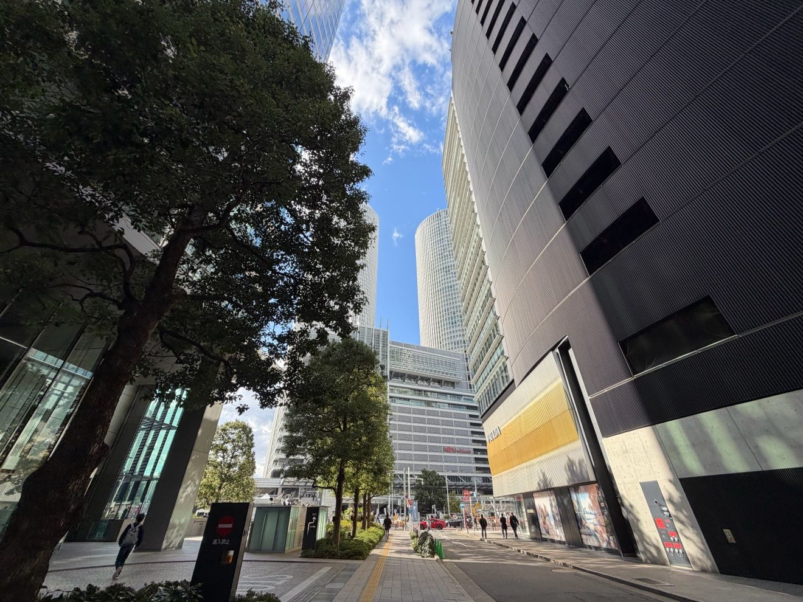

2026年11月20日から22日まで名古屋で開催される、全国語学教育学会（Japan Association for Language Teaching）の年次大会 JALT2026 に、参加者として出席します。言語教育におけるAIや量的エスノグラフィーに取り組んでいて、当日いらっしゃる方がいれば、ぜひお会いできればと思います。参加される方は、[JALT でお会いするためにメールをお送りください](mailto:tianshihao@hiroshima-u.ac.jp)。

*会場の外、名古屋・ウインクあいち。*
