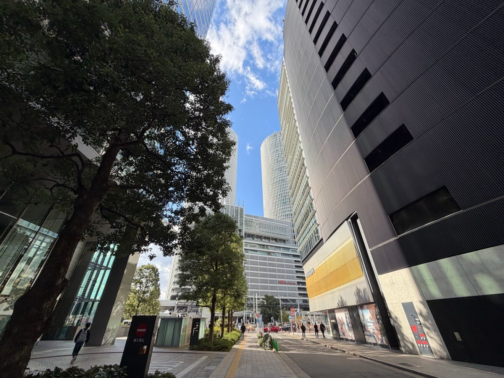

I will attend JALT2026, the annual conference of the Japan Association for Language Teaching, held in Nagoya from November 20 to 22, 2026, as a participant. If you are working on AI in language education or quantitative ethnography and will be there, I would be glad to meet. If you will be there too, [Email me to meet at JALT](mailto:tianshihao@hiroshima-u.ac.jp).

*Outside the venue, WINC Aichi, Nagoya.*
