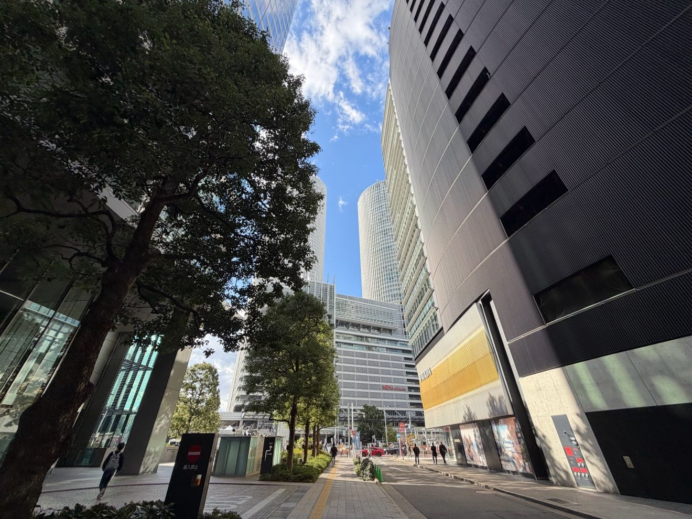

我将作为与会者参加 JALT2026——日本语言教育学会（Japan Association for Language Teaching）的年会，会议于 2026 年 11 月 20 日至 22 日在名古屋举行。如果您从事语言教育中的人工智能或定量民族志研究，并且也会到场，我很乐意与您见面。如果您也去，[给我发邮件在 JALT 见面](mailto:tianshihao@hiroshima-u.ac.jp)。

*会场外，名古屋 WINC Aichi。*
